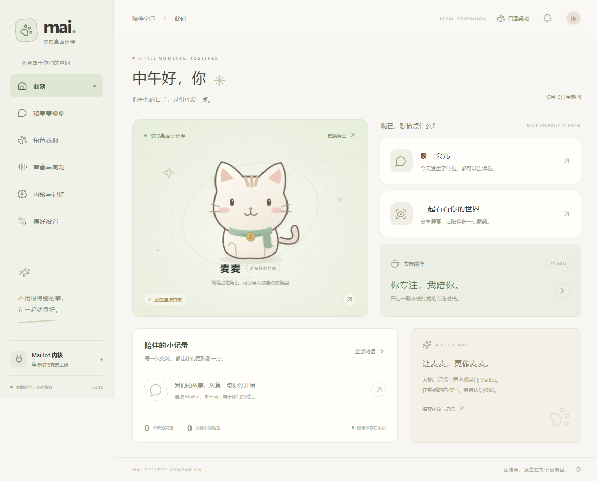

# Mai · 桌面伙伴

以 **MaiBot 为对话内核**、参考 [N.E.K.O](https://github.com/Project-N-E-K-O/N.E.K.O) 桌面陪伴体验开发的 Windows 桌宠。Electron + React + TypeScript；不附带第三方角色模型，可导入自己的角色。

桌宠可通过本仓库 `adapter/` 内的**独立 Python 适配器**接入 MaiBot 官方经典消息服务，按官方 `maim_message` 协议收发私聊。人格、回复策略、表达学习、长期记忆、插件与工具由 MaiBot 负责。原 MessageGateway 网关插件和 QQ 服务器接入继续保留；主动陪伴需要网关插件提供的任务接口。

桌宠客户端与新独立适配器位于私有仓库 [desktop_mai](https://github.com/pan-ice/desktop_mai)，需要访问权限。首次获取：

```powershell
gh repo clone pan-ice/desktop_mai
cd desktop_mai
```

MaiBot 由部署方独立安装，客户端仓库不包含 `MaiBot/`。仅在需要原 QQ 服务器、云端历史或主动陪伴时，另行获取原[网关插件仓库](https://github.com/pan-ice/desktop_pet_adapter)，放入 `MaiBot/plugins/desktop_pet_adapter`。



0.4.1 支持 **100 MiB 原始音频**，即时回复、云端历史恢复和本地媒体保存使用相同上限；需同步更新网关插件与中继至 0.4.5。用户输入和图片限制保持原值。音乐插件下载超过其自身限制的文件时，还需将 `music.cache_max_file_size_mb` 设置为 `100` 或更大。

## 启动

Node.js **22.12+**（开发环境已使用 Node.js 24 验证）。

```powershell
cd D:\project\desktop_mai
npm ci
npm run dev
```

也可以双击 `启动桌宠.cmd`，或先构建再运行：

```powershell
npm run build
npm start
```

Windows 便携版构建：

```powershell
npm run dist:win
```

生成 `release/Mai-Desktop-Pet-0.4.1-win-x64.exe` 和独立的 `MaiBot-Desktop-Message-Adapter-0.1.0.zip`。桌宠无需安装 Node.js 即可运行；新适配器解压到独立目录，以 Python 进程运行。发行包不包含内核、凭证或角色模型。原网关插件可在获取其源码后使用 `npm run dist:plugin-adapter` 单独打包。

## 官方消息协议接入

新适配器位于 [adapter/](adapter/README.md)，按官方[概览](https://docs.mai-mai.org/develop/adapters/)、[协议](https://docs.mai-mai.org/develop/adapters/protocol)、[编写指南](https://docs.mai-mai.org/develop/adapters/build)、[策略](https://docs.mai-mai.org/develop/adapters/policy)与[排错](https://docs.mai-mai.org/develop/adapters/debugging)实现。

1. 独立启动 MaiBot，配置好模型服务。经典消息地址默认 `ws://127.0.0.1:8000/ws`。
2. 在 MaiBot `[bot].platforms` 现有列表中追加 `"desktop_pet:mai_desktop_pet"`，设置 `[maim_message].auth_token` 并重启。已有同平台桌宠网关需停用，避免抢占回复通道。
3. 桌宠「连接与账号」→「独立适配器接入」→「导出配置并开启接入」，保存到 `adapter/config.toml`。
4. 在导出配置中填写 MaiBot 的地址和令牌原文；桌宠令牌已经单独填好。在 `adapter/` 执行：

   ```powershell
   uv sync --locked
   uv run --locked python -m desktop_adapter --config config.toml
   ```

需要 Python **3.11+**。固定官方 `maim-message==0.6.8`，不使用传输已变更的 0.7 开发版。私聊身份和策略、容器部署、回执语义、媒体支持及限制见[适配器说明](adapter/README.md)，协议核对来源见[参考笔记](docs/adapter-protocol-reference.md)。经典消息模式支持文字、图片与语音回复；QQ 登录、服务器历史同步和主动陪伴继续由原服务器/网关模式提供。

## 多人服务器

0.4.0 支持 QQ 验证登录：一个 QQ 可以创建多个独立桌宠账号，每个账号可以由多台设备同时使用。新设备通过 QQ 私聊机器人确认登录码后，选择已有桌宠即可恢复服务器聊天记录，也可以新建一个桌宠。人物标识只保留在服务端，不由用户填写或传给客户端。

用户打开「连接与账号」，填写服务器地址，点击「通过 QQ 登录」，用自己的 QQ 私聊 MaiBot 发送显示的 `/桌宠登录 登录码`。确认后选择或新建桌宠；设备管理按需展开。聊天记录及已发送附件保存在同一台服务器的 SQLite 数据库，支持跨设备同步、分页加载和分账号清空，无需第三方云服务。模型文件和声音设置仍保存在本机。旧管理员凭证可在「旧版接入」中导入，原有账号和聊天记录继续保留。

操作与预览验证见 [QQ 登录说明](docs/qq-login.md)，服务器部署及 Caddy/systemd 示例见 [多人服务器指南](MaiBot/plugins/desktop_pet_adapter/SERVER.md)。

本机测试可点击「本机测试（自动初始化）」，自动准备配套配置并启动中继，再启动或重载 MaiBot、通过 QQ 登录。默认地址为 `ws://127.0.0.1:18766/desktop`，重复准备保留账号和聊天记录，退出桌宠会回收自己启动的中继。

使用 `wss://IP:端口/desktop` 且服务器采用自签名证书或私有 CA 时，先填写服务器地址，再在地址下方点击「导入」选择 CA 或自签名服务器证书。支持 PEM、CRT、CER、DER 及 PEM 证书链；只分发公钥证书，**不要把服务器私钥复制到客户端**。证书会按 IP / 主机绑定并同时用于 `/desktop` 与 `/account`，客户端仍校验证书有效期和主机名；IP 证书必须在 Subject Alternative Name 中包含对应 IP。

共享实例的人格、模型、插件和部分全局学习数据由管理员统一维护。独立会话不代表完整的数据租户隔离；长期记忆共享与人物画像范围详见部署指南。

## 原插件接入（兼容）

以下为原网关插件路线，需要单独克隆上游 `MaiBot/` 与 `MaiBot/plugins/desktop_pet_adapter`。内核源码保持不变，插件保留独立 Git 历史。要求 MaiBot **1.3.5–1.3.x**、SDK **2.10+ / <3**、Python **3.12+**；使用上面的独立适配器时无需完成本节。

1. 安装 Python 3.12+ 与 uv，在 MaiBot 目录执行 `uv sync`。
2. 执行 `uv run bot.py`，在终端阅读并确认 MaiBot 的协议与隐私条款，完成配置生成。
3. 按 MaiBot 指引，在它的管理界面配置对话与视觉模型的服务地址、模型名和 API Key。
4. 将原网关插件 ZIP 解压到 `MaiBot/plugins`，或克隆原插件源码。在 MaiBot 目录执行下列命令安装公开依赖：

   ```powershell
   uv pip install --python .venv/Scripts/python.exe -r plugins/desktop_pet_adapter/requirements.txt
   ```

5. 使用原本机适配器接入时，展开桌宠「连接与账号」→「旧版接入」→「本机适配器接入」，默认端口 **18765**。点击「导出插件配置」，保存为 `MaiBot/plugins/desktop_pet_adapter/config.toml`，包含自动生成的独立令牌，再保存并开启接入。
6. 启动或重载 MaiBot，桌宠显示 **“协议 v1 · 会话已确认”** 后即可聊天。插件自动注册账号路由；如内核配置了适配器名单策略，需要允许该私聊。MaiBot 管理界面的默认地址是 `http://127.0.0.1:8001`。

桌宠监听本机回环地址，插件主动连接，支持新旧插件实例并存的重载过程。插件令牌独立于 WebUI、模型服务和旧消息服务令牌。配置文件含凭证，请妥善保存；桌宠本地使用系统加密保存令牌。

桌宠默认使用固定的 `desktop_owner` 身份；插件通过 `ctx.chat.open_session` 获取真实私聊流。保持平台、机器人账号、用户 ID 与空作用域可延续原有归属。远程内核、多套桌宠、消息回执及协议版本见 [插件说明](MaiBot/plugins/desktop_pet_adapter/README.md) 与 [维护指南](docs/maintenance.md)。

从 0.1.0 升级时，会先备份 `state.v1.backup.json`，保留历史、角色、语音配置和身份，停用旧自动连接。到本页面导出插件配置完成迁移；旧内核令牌不会复用，也不会继续走旧协议。无需再为桌宠添加 `bot.platforms` 条目，已有其他平台配置照常保留。

MaiBot 由部署方独立启动和管理，桌宠客户端只负责连接、登录和日常使用，不提供 MaiBot 启动、停止或管理后台配置。需要本机测试时展开相应入口；它仅管理桌宠中继，不管理 MaiBot 进程。

## 已实现的功能

| 能力       | 使用方式                                                                                                  |
| ---------- | --------------------------------------------------------------------------------------------------------- |
| 透明桌宠   | 无边框、位置锁定与拖动、屏幕边界限制、置顶、缩放、鼠标穿透、托盘、全局召回快捷键                          |
| 文字聊天   | 完整聊天页、桌宠迷你输入框、回复气泡、图片 / 表情 / 语音接收、@ 与引用展示、混合消息顺序保留、失败提示      |
| 语音对话   | 手动录音、ASR 转写、连续语音 VAD 分句、原音频顺序播放、系统 / 模型朗读、五家在线音色复刻                   |
| 屏幕理解   | 屏幕 / 窗口选择、截图预览、图片消息、可选定时屏幕陪伴、重复画面过滤                                       |
| 摄像头     | 摄像头选择、拍照、预览后分享，关闭预览即释放设备                                                          |
| 主动陪伴   | 空闲后向内核提交陪伴意图、可配置意图和频率、跨午夜免打扰、专注时暂停                                      |
| 专注陪伴   | 25 分钟专注、倒计时、安静状态、结束通知                                                                   |
| 模型导入   | 图片 / GIF、PNGTuber、Live2D Cubism 3 / 4、VRM 0 / 1、GLB、PMX / PMD                                      |
| 动画表现   | 呼吸、眨眼、开心、思考、睡眠、语音口型；VRM 视线及 MMD 常用表情映射                                       |
| 人格与记忆 | 使用所连接 MaiBot 的实际人格和记忆系统，由部署方管理                                                      |
| 插件与工具 | 使用 MaiBot 已配置的插件与工具能力，由部署方管理                                                          |
| 本地数据   | 设置持久化、最近 1,000 条记录、媒体单独保存、JSON 导出与清空、系统加密令牌                                |
| 内核连接   | 独立消息适配器 / 网关插件、认证和能力握手、保存后消息 ID 回执、断线重连；主动任务与真实会话确认由网关提供 |
| 多人服务器 | 每人独立凭证、私聊与回复路由、凭证撤销、账号限流、断线重连；支持外部 WS/WSS 接入，公网建议使用 WSS        |

消息类型、两种内核结构的映射与未支持类型的处理见 [消息对接说明](docs/message-types.md)。

模型朗读支持硅基流动、阿里云百炼、MiniMax、火山引擎、小米 MiMo；各自保存 Key、模型及复刻音色。在「声音与感知」选择服务商，提交参考材料，音色就绪后点击「使用音色」和「试听声音」。百炼需公网参考音频链接，火山采用新版 API Key 和音色槽位 / 自定义 ID。MiMo 可选择预置音色，或在本机保存 MP3 / WAV 参考音色并随每次合成请求发送。配置、计费差异与验证范围见 [在线音色复刻](docs/voice-cloning.md)。录音转写独立配置，MaiBot 已发来的语音直接按顺序播放。

桌宠默认锁定位置，避免点击时误拖。点击角色旁的锁按钮可解锁后拖动，摆好位置后再次点击即可锁定；「偏好设置」和托盘菜单也能切换「锁定桌宠位置」，重启保留选择。

连续语音采用 **语音检测 → ASR → MaiBot → TTS**，仍由 MaiBot 生成回复。它不是直连其他模型的 Realtime API 旁路。模型与插件支持取决于你配置的 MaiBot 与服务商。

「自动屏幕陪伴」默认关闭。先选择目标窗口，再启用独立开关；它按间隔向内核分享变化的画面。断线、专注、免打扰或隐藏桌宠时暂停，目标窗口消失时关闭该功能并提示。

N.E.K.O 的 Steam 创意工坊、猫娘网络、手机端、专有账号 / 云同步和专用游戏插件属于其独立生态，本项目没有复制这些服务；对应扩展通过 MaiBot 插件接入。具体边界见 [实现与验证说明](docs/implementation.md)。

## 角色资源

在「角色衣橱」点击「导入角色」，程序将需要的资源复制到应用数据目录。

- 图片：PNG / JPG / WebP / GIF，可直接选文件。
- PNGTuber：同目录准备 `idle.png`、`talking.png` 与以下 JSON，选择 JSON 导入。

  ```json
  { "name": "我的麦麦", "idle": "idle.png", "talking": "talking.png" }
  ```

- Live2D：选择 `.model3.json`，自动复制所引用的 moc3、贴图、动作与表情。**只有完整的模型文件也能导入**：首次找不到 Core 时，应用会从 [Live2D 官方](https://cubism.live2d.com/sdk-web/cubismcore/live2dcubismcore.min.js) 自动下载运行库，成功后继续导入。也可在「角色衣橱」点击「下载官方运行库」提前准备；已有 `live2dcubismcore.min.js` 时选择「从本地导入」，或放在模型入口文件旁边。下载使用系统网络和代理，失败后可重试或改用本地导入。Core 保存在应用数据目录，下载一次后可离线复用，移动原文件或移除角色均不影响；旧版角色的 Core 会自动沿用。需要升级时点击「更新官方运行库」，正在显示的模型会重新加载。Core 不打入应用安装包，使用遵循其文件中的官方许可。支持 Cubism 3 / 4 的 `.model3.json`，已使用 Core 5.1.0 实测 Cubism 5.0 导出的洛天依「翡翠石」模型；其他 Cubism 5 模型仍需逐个验证，暂不支持 Cubism 2 的 `.model.json`。
- VRM / GLB：选择包含完整资源的单个 `.vrm` / `.glb` 文件。
- MMD：将 `.pmx` / `.pmd` 及贴图放在独立文件夹中，选择模型文件；导入同文件夹内的模型资源。当前提供静态模型、呼吸与常见表情 / 口型映射，未包含 MMD 物理或 VMD 动作时间线。

模型不能引用导入目录外的文件或远程 URL，单次导入上限 512 MB。程序不下载或分发角色模型。

## 声音与设备

系统朗读无需 API，声音取决于 Windows 已安装的语音包。

录音转写与 API 朗读使用「声音与感知」中配置的兼容服务：`POST /audio/transcriptions`、`POST /audio/speech`，会保留 Base URL 中的 `/v1` 等前缀。本地兼容服务可以不填 API Key。先保存配置，再使用录音测试；测试转写不会自动发消息。

连续语音只在桌宠窗口运行，点击连续语音按钮或对应开关开始；每段最长 45 秒。朗读期间暂停检测，隐藏桌宠、断线或开启专注会关闭连续语音。

`Ctrl + Shift + M` 召回桌宠与控制面板，并恢复鼠标交互。主窗口关闭后保留托盘；托盘菜单「退出 Mai」才结束应用。

## 数据与开发

默认数据目录：`%APPDATA%\Mai Desktop Pet`，可在「偏好设置」中打开。开发测试使用 `MAI_USER_DATA` 指定隔离目录。

```text
electron/        Electron 主进程、协议桥接、本地数据与设备操作
adapter/         独立 Python 适配器、官方消息协议转换、配置与锁文件
shared/          共享类型、配置默认值与 IPC 输入校验
src/             React 控制面板、桌宠、语音与模型渲染器
resources/       应用图标
tests/           协议、重连、模型导入、媒体存储、陪伴策略测试
scripts/         插件打包、桌面与实际 SDK 联调、进程生命周期验收
MaiBot/          独立上游内核仓库
  plugins/desktop_pet_adapter/   独立适配器仓库，包含锁文件、协议、测试和 CI
references/      开发参考仓库，不进入应用打包
```

```powershell
npm run typecheck
npm test
npm run build
npm run test:message-adapter
npm run test:plugin
npm run test:adapter
npm run test:desktop
```

插件开发环境可独立初始化；跨语言与桌面测试使用它的解释器：

```powershell
cd MaiBot/plugins/desktop_pet_adapter
uv sync --locked
cd ../../..
# 可通过 MAI_PYTHON 指定其他已安装 SDK 和 websockets 的解释器。
npm run test:plugin
npm run test:adapter
```

桌面测试使用本地测试服务、生成的几何模型与虚拟音视频设备，结束时关闭所有测试应用和服务；不会使用你的模型 Key 或向在线模型发送请求。

长期维护的模块约定、版本策略和发布检查见 [维护指南](docs/maintenance.md)。插件是单独的私有仓库，克隆桌宠仓库时需按上方步骤获取到该路径；发布 ZIP 提供完整插件源码。尚未发布到插件市场。
